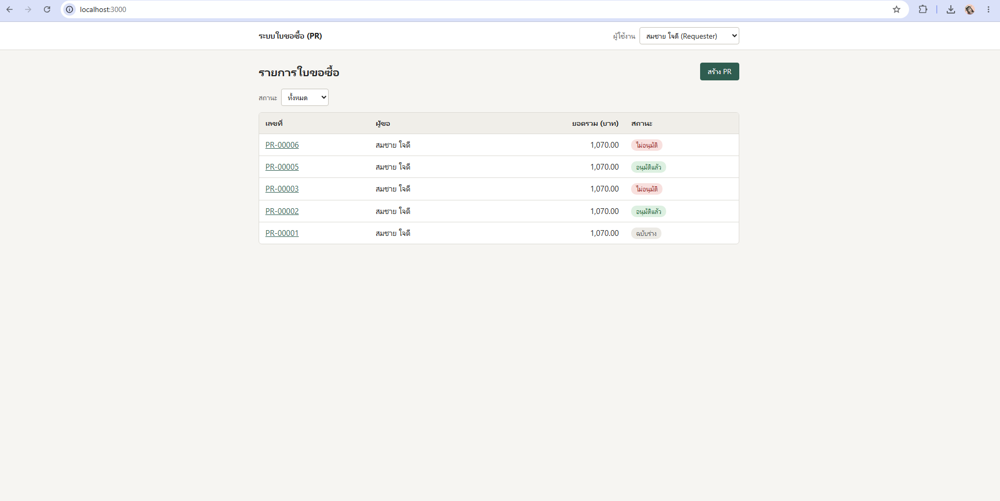
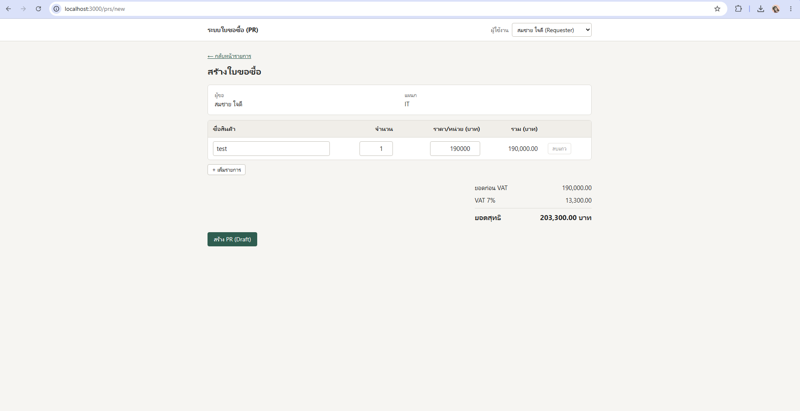
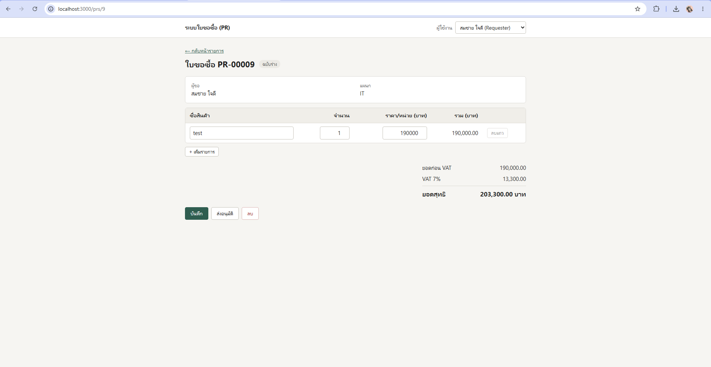
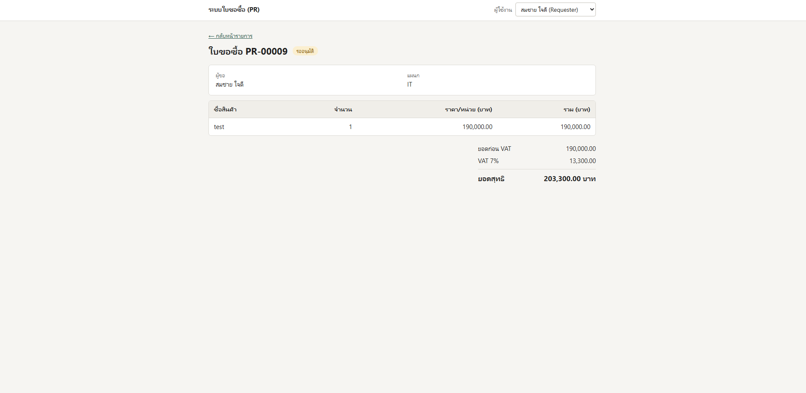
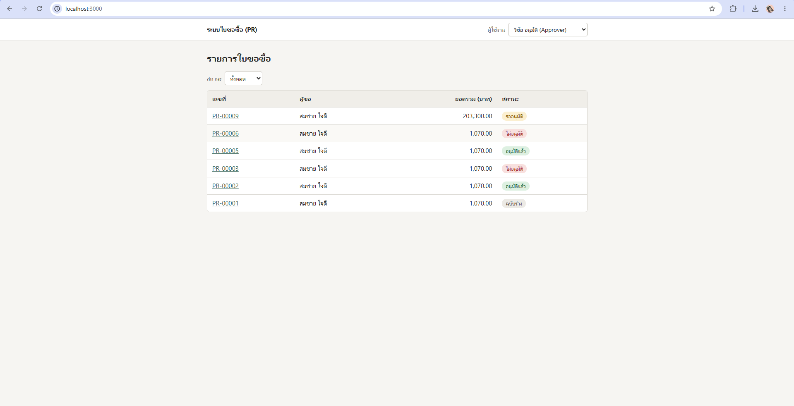
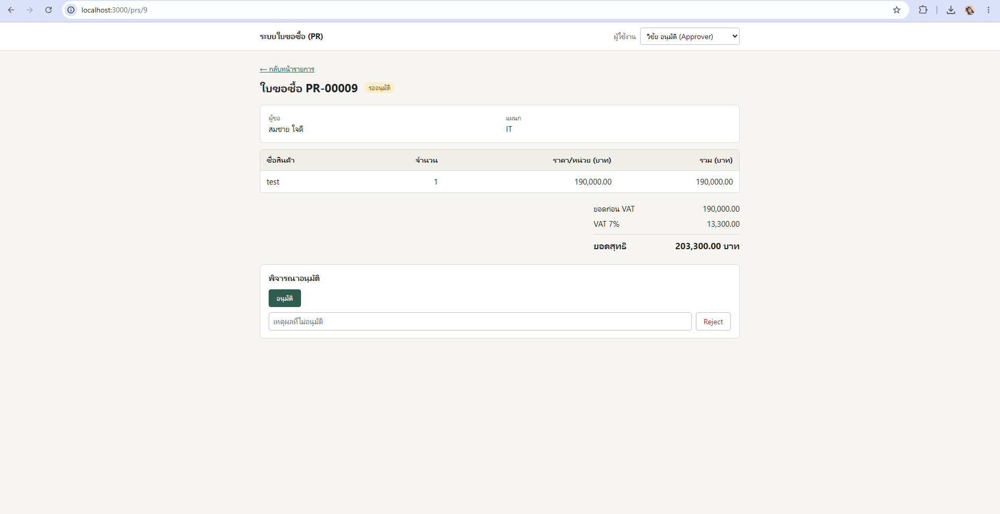
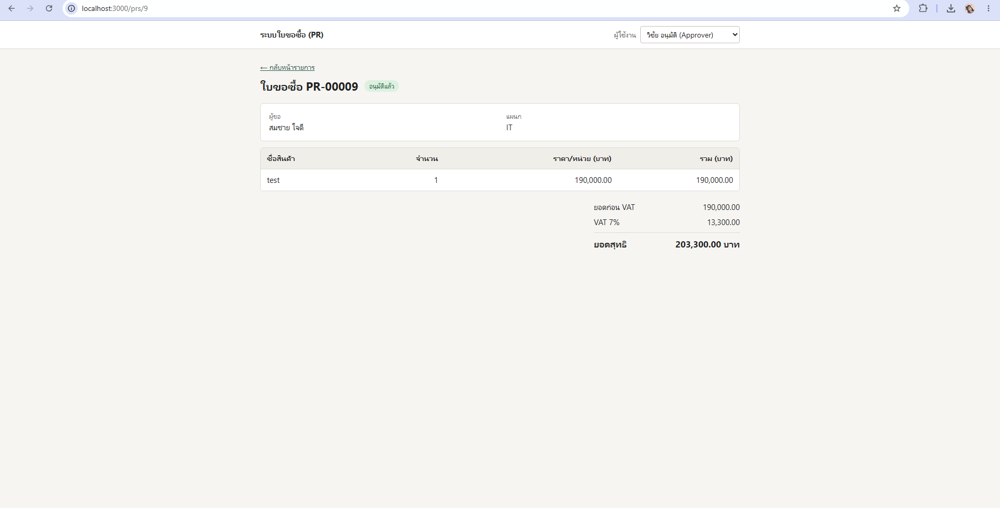
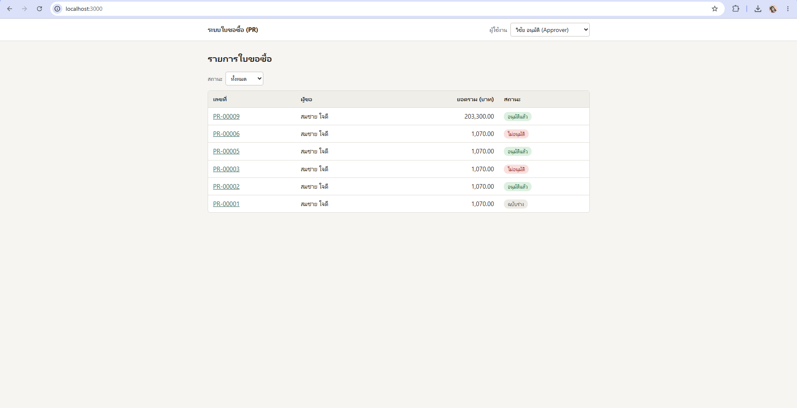
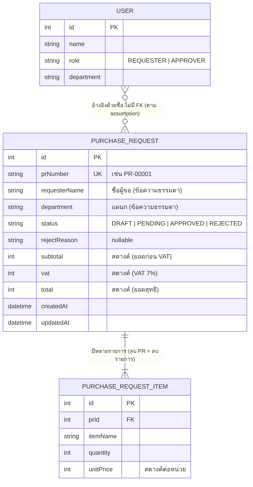
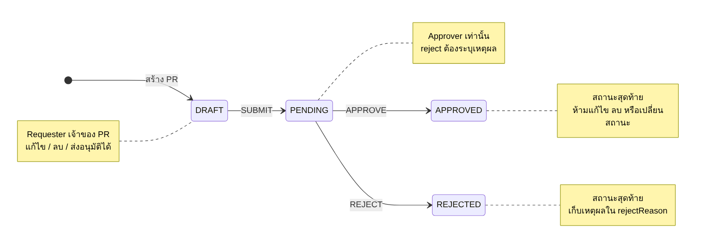

# ระบบใบขอซื้อ (PR Management System)

เว็บแอปสำหรับสร้างใบขอซื้อ (Purchase Request) คำนวณยอดเงินพร้อม VAT 7% และส่งอนุมัติ
พัฒนาด้วย Next.js (App Router) เป็น Monolith 1 โปรเจกต์ มีทั้งหน้าเว็บและ API ในที่เดียว

- Next.js 14 + TypeScript
- Prisma + SQLite
- Vitest สำหรับ unit test

## วิธีติดตั้งและรัน

ต้องมี Node.js 18.18 ขึ้นไป (แนะนำ 20)

```bash
npm install
npm run setup
npm run dev
```

เปิด http://localhost:3000

คำสั่งอื่นที่ใช้บ่อย

| คำสั่ง                        | ทำอะไร                                                                |
| ----------------------------- | --------------------------------------------------------------------- |
| `npm test`                    | รัน unit test (การคำนวณเงิน และการเปลี่ยนสถานะ)                       |
| `npm run setup`               | รีเซ็ตฐานข้อมูลกลับเป็นข้อมูลตัวอย่าง (รันซ้ำได้ ข้อมูลเดิมจะถูกล้าง) |
| `npm run build` / `npm start` | build และรันแบบ production                                            |

## วิธีใช้งานเบื้องต้น

ระบบไม่มี login ให้เลือกผู้ใช้จาก dropdown มุมขวาบนของทุกหน้า ผู้ใช้ตัวอย่างจาก seed มี 3 คน

| ชื่อ          | Role      | แผนก       |
| ------------- | --------- | ---------- |
| สมชาย ใจดี    | Requester | IT         |
| สมหญิง รักงาน | Requester | Marketing  |
| วิชัย อนุมัติ | Approver  | Management |

ลำดับการใช้งาน

1. เลือกผู้ใช้เป็น **Requester** แล้วกด "สร้าง PR" ที่หน้ารายการ
2. กรอกรายการสินค้า (ชื่อ จำนวน ราคาต่อหน่วย) ดูยอดก่อน VAT, VAT 7% และยอดสุทธิได้ทันที แล้วกด "สร้าง PR (Draft)"
3. ตอนที่ PR ยังเป็นฉบับร่าง เจ้าของแก้ไข ลบ หรือกด "ส่งอนุมัติ" ได้
4. สลับเป็น **Approver** เปิด PR ที่รออนุมัติ แล้วกด "อนุมัติ" หรือ "Reject" (ต้องกรอกเหตุผล)
5. PR ที่อนุมัติหรือไม่อนุมัติแล้วเป็นสถานะสุดท้าย แก้ ลบ หรือเปลี่ยนสถานะอีกไม่ได้

หน้ารายการกรองตามสถานะได้ และคลิกเลขที่ PR เพื่อเปิดรายละเอียด

## Screenshot

### มุมมอง Requester

หน้ารายการ PR



สร้าง PR



แก้ไข PR (ฉบับร่าง)



PR ที่ส่งอนุมัติแล้ว รอผู้อนุมัติ



### มุมมอง Approver

หน้ารายการ PR ที่รออนุมัติ



หน้ารายละเอียด PR พร้อมปุ่มอนุมัติ / Reject



หลังกดอนุมัติ



หน้ารายการหลังอนุมัติ



## ER Diagram



ต้นฉบับ Mermaid: [docs/er-diagram.mmd](docs/er-diagram.mmd)

## State Diagram



ต้นฉบับ Mermaid: [docs/state-diagram.mmd](docs/state-diagram.mmd)

## API

ทุก request ต้องส่ง header `x-user-id` (id ของผู้ใช้ที่เลือกจาก dropdown)

| Method | Path                      | ใครทำได้   | หมายเหตุ                                       |
| ------ | ------------------------- | ---------- | ---------------------------------------------- |
| GET    | `/api/users`              | ทุกคน      | ใช้กับ dropdown เลือกผู้ใช้                    |
| GET    | `/api/prs?status=PENDING` | ทุก role   | `status` ไม่ใส่ = ทั้งหมด                      |
| POST   | `/api/prs`                | Requester  | สร้าง PR สถานะ DRAFT                           |
| GET    | `/api/prs/:id`            | ทุก role   | พร้อมรายการสินค้า                              |
| PUT    | `/api/prs/:id`            | เจ้าของ PR | เฉพาะ DRAFT                                    |
| DELETE | `/api/prs/:id`            | เจ้าของ PR | เฉพาะ DRAFT                                    |
| POST   | `/api/prs/:id/submit`     | เจ้าของ PR | DRAFT → PENDING                                |
| POST   | `/api/prs/:id/approve`    | Approver   | PENDING → APPROVED                             |
| POST   | `/api/prs/:id/reject`     | Approver   | PENDING → REJECTED, body `{ "reason": "..." }` |

กรณีผิดกฎ API ตอบ 400 (ข้อมูลไม่ถูกต้อง), 401 (ไม่พบผู้ใช้), 403 (ไม่มีสิทธิ์), 404 (ไม่พบ PR), 409 (สถานะไม่ถูกต้อง)

## โครงสร้างโปรเจกต์

```
app/
  page.tsx               หน้ารายการ PR
  prs/[id]/page.tsx      หน้ารายละเอียด (ใช้ /prs/new สำหรับสร้างใหม่)
  api/                   Route Handlers
  components/            UserSwitcher, StatusBadge
lib/
  pr/calculator.ts       คำนวณเงิน และตรวจรายการสินค้า
  pr/status.ts           กฎการเปลี่ยนสถานะ และตรวจสิทธิ์ตาม role
  pr/service.ts          ขั้นตอนของแต่ละ use case (ต่อ database)
  http.ts                helper ของ API (อ่านผู้ใช้, จัดการ error)
  client/                ฟังก์ชันและ hook ฝั่งหน้าเว็บ
prisma/
  schema.prisma
  seed.ts
docs/                    ER diagram, State diagram, screenshot
```

กฎทั้งหมดตรวจที่ฝั่ง server ใน `lib/pr/` หน้าเว็บซ่อนปุ่มตาม role และสถานะเพื่อความสะดวกเท่านั้น
ส่วนยอดที่แสดงตอนกรอกฟอร์มเป็นค่าประมาณจากฟังก์ชันตัวเดียวกับ server แต่ยอดที่บันทึกจริงคำนวณที่ server ใหม่ทุกครั้ง

## Assumption

1. **ไม่มี login** ผู้ใช้ถูกเลือกจาก dropdown แล้วส่ง `x-user-id` ไปกับ request server นำ id ไปหาผู้ใช้ใน DB แล้วใช้ role จาก DB (ไม่เชื่อ role ที่ client ส่งมา)
2. **เก็บเงินเป็นสตางค์ (จำนวนเต็ม)** ทั้งใน DB และ API เพื่อเลี่ยงปัญหาทศนิยม หน้าเว็บแปลงบาท ↔ สตางค์ให้ ราคาที่กรอกเกิน 2 ตำแหน่งจะถูกปัดเป็นสตางค์
3. **ราคาต่อหน่วยยังไม่รวม VAT** VAT 7% คิดจากยอดรวมทั้งใบ (ไม่คิดทีละรายการ) แล้วปัดเศษเป็นสตางค์ที่ .5 ขึ้นไปปัดขึ้น
4. **ชื่อผู้ขอและแผนกใน PR เก็บเป็นข้อความ** คัดลอกจากผู้ใช้ตอนสร้าง ไม่มี FK ไปตาราง User การตรวจว่าใครเป็นเจ้าของ PR จึงเทียบด้วยชื่อ ดังนั้นชื่อผู้ใช้ต้องไม่ซ้ำกัน
5. **สร้าง PR ได้เฉพาะ Requester** และแก้ไข ลบ ส่งอนุมัติได้เฉพาะเจ้าของ PR นั้น เฉพาะตอนเป็น Draft
6. **Approver อนุมัติหรือ reject ได้ทุก PR ที่รออนุมัติ** ไม่จำกัดแผนกหรือวงเงิน (อนุมัติขั้นเดียวตามโจทย์) และ Approver สร้างหรือแก้ PR ไม่ได้
7. **Approved และ Rejected เป็นสถานะสุดท้าย** แก้ ลบ หรือส่งใหม่ไม่ได้ ถ้า PR ถูก reject ต้องสร้าง PR ใหม่
8. **การลบ PR เป็นการลบจริง** รายการสินค้าของ PR นั้นถูกลบตามไปด้วย
9. **เลขที่ PR** ออกให้อัตโนมัติรูปแบบ `PR-00001` จาก id
10. **ทุก role ดูรายการและรายละเอียด PR ได้ทุกใบ** ไม่แยกตามเจ้าของหรือแผนก
11. **ข้อกำหนดของรายการสินค้า** PR ต้องมีอย่างน้อย 1 รายการ ชื่อสินค้าห้ามว่าง จำนวนเป็นจำนวนเต็มมากกว่า 0 ราคาต่อหน่วยเป็น 0 ได้แต่ติดลบไม่ได้
12. **ปุ่ม "ส่งอนุมัติ"** บันทึกรายการล่าสุดในฟอร์มก่อน แล้วจึงส่ง เพื่อไม่ให้ส่งข้อมูลที่ค้างอยู่ในหน้า
13. **กันการกดชนกัน** การแก้ไข ลบ และเปลี่ยนสถานะจะเช็กสถานะเดิมตอนเขียน DB อีกครั้ง ถ้ามีคนเปลี่ยนสถานะไปก่อนจะได้ 409
14. **ฐานข้อมูล** ใช้ SQLite ผ่าน Prisma และสร้างตารางด้วย `prisma db push` (ไม่มี migration เพราะเป็นงานขนาดเล็ก)
